# ResearchCrew — Complete Flow Diagram

This file shows exactly what happens between typing a topic and getting
a report. It covers the CLI, the graph, every agent, every tool call,
the memory layer, the tracing layer, and every exit point.

Diagrams use Mermaid, which renders natively on GitHub, GitLab, VS Code
(with the Markdown Preview Mermaid extension), and Obsidian.

---

## 1. High-level architecture

```mermaid
graph TB
    User["User types topic<br/>python cli.py 'quantum computing'"]

    subgraph CLI["rc-core/cli.py"]
        GetLLM["get_llm()<br/>build provider chain"]
        BuildGraph["build_graph(llm)<br/>compile StateGraph"]
        InitTracing["init_tracing()<br/>feenion.configure"]
        SetSession["feenion.set_session(tid)"]
        Invoke["graph.invoke(state)"]
        Store["store(topic, draft, findings)<br/>best-effort"]
    end

    subgraph Graph["LangGraph StateGraph"]
        Start([START])
        Researcher[Researcher]
        Writer[Writer]
        Critic[Critic]
        End([END])
        Decide{{decide(state)}}
    end

    subgraph Tools["rc-core/tools/"]
        LLM["llm.py<br/>FreeLLM failover"]
        Search["search.py<br/>ddgs"]
        Memory["memory.py<br/>pgvector"]
        Tracing["tracing.py<br/>feenion"]
    end

    subgraph External["External services"]
        Postgres[(Postgres + pgvector<br/>localhost:5432)]
        Feenion["feenion server<br/>localhost:8000<br/>or JSONL"]
        Web["DuckDuckGo"]
        Providers["Gemini / Mistral<br/>OpenRouter / NVIDIA NIM"]
    end

    User --> GetLLM
    GetLLM --> BuildGraph
    BuildGraph --> InitTracing
    InitTracing --> SetSession
    SetSession --> Invoke
    Invoke --> Start

    Start -.-> Decide
    Researcher -.-> Decide
    Writer -.-> Decide
    Critic -.-> Decide

    Decide -->|"no findings"| Researcher
    Decide -->|"no draft"| Writer
    Decide -->|"no critique"| Critic
    Decide -->|"rejected, rev<3"| Writer
    Decide -->|"approved or capped"| End

    Researcher --> LLM
    Researcher --> Search
    Researcher --> Memory
    Writer --> LLM
    Critic --> LLM

    LLM --> Providers
    Search --> Web
    Memory --> Postgres
    Invoke --> Tracing
    Tracing --> Feenion

    End --> Store
    Store --> Memory

    style Start fill:#4caf50,color:#fff
    style End fill:#4caf50,color:#fff
    style Decide fill:#ff9800,color:#fff
    style Postgres fill:#2196f3,color:#fff
    style Feenion fill:#2196f3,color:#fff
```

---

## 2. Startup sequence

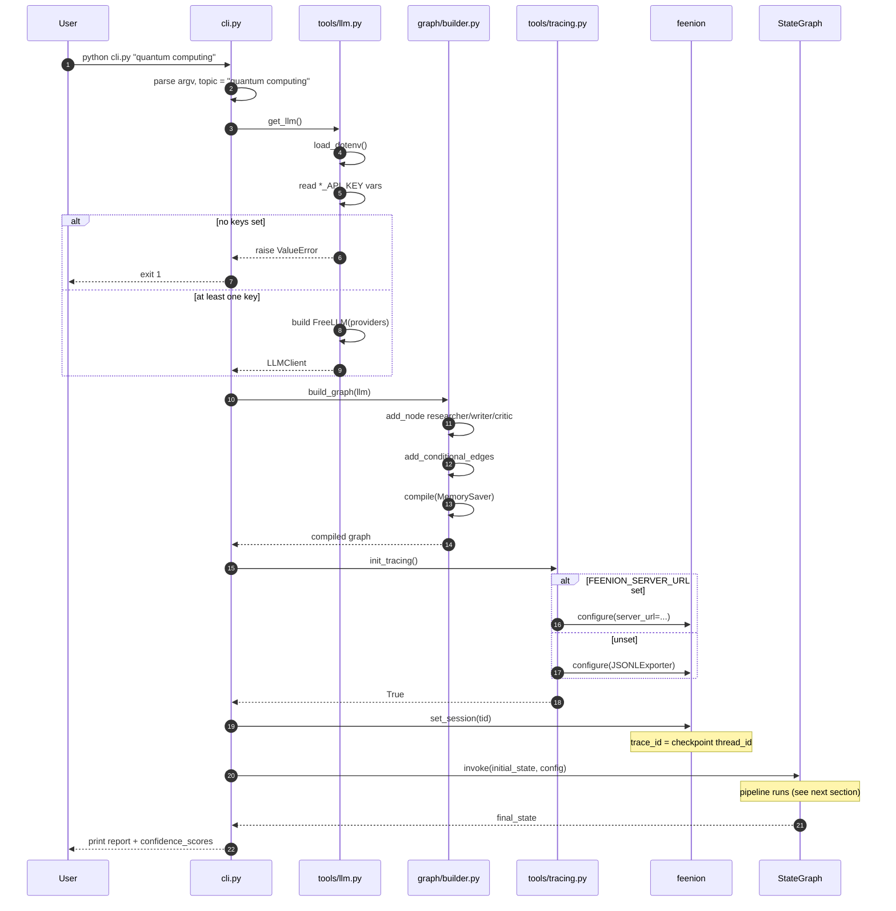

---

## 3. The routing function

`decide(state)` runs before every node and after every node. No LLM.
Fifteen lines. Pure function.

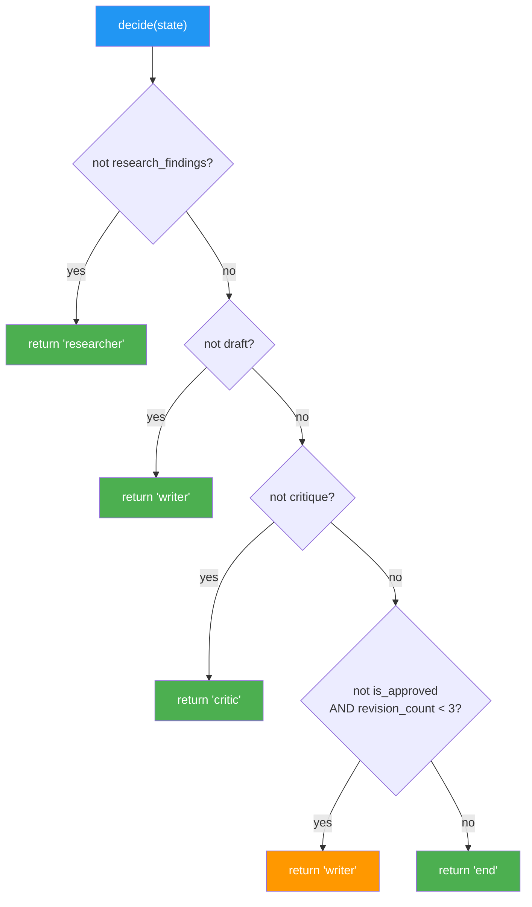

**Rule:** structural checks precede content checks. "Has the Critic
run?" (empty critique) is checked before "was the Critic happy?"
(`is_approved`).

---

## 4. Full success path — first-pass approval

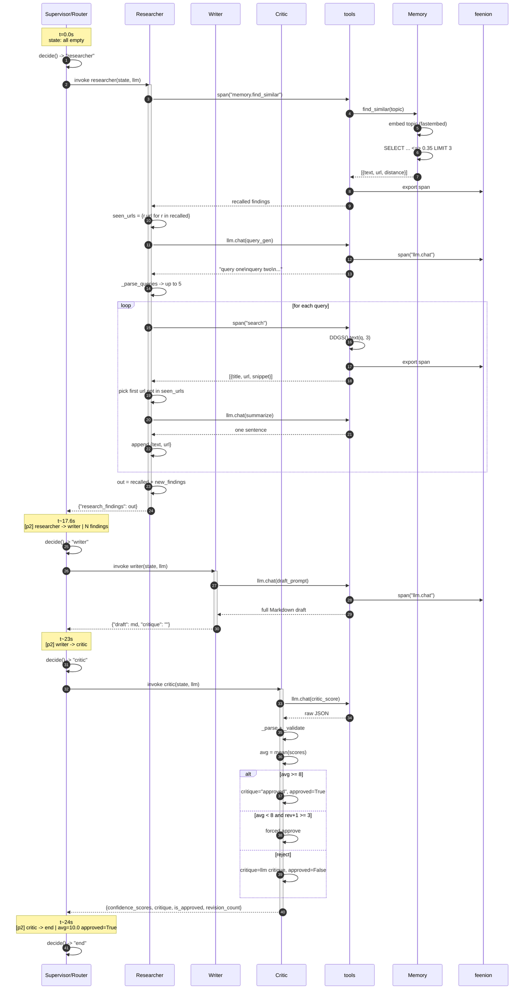

---

## 5. Rejection loop — Critic rejects once

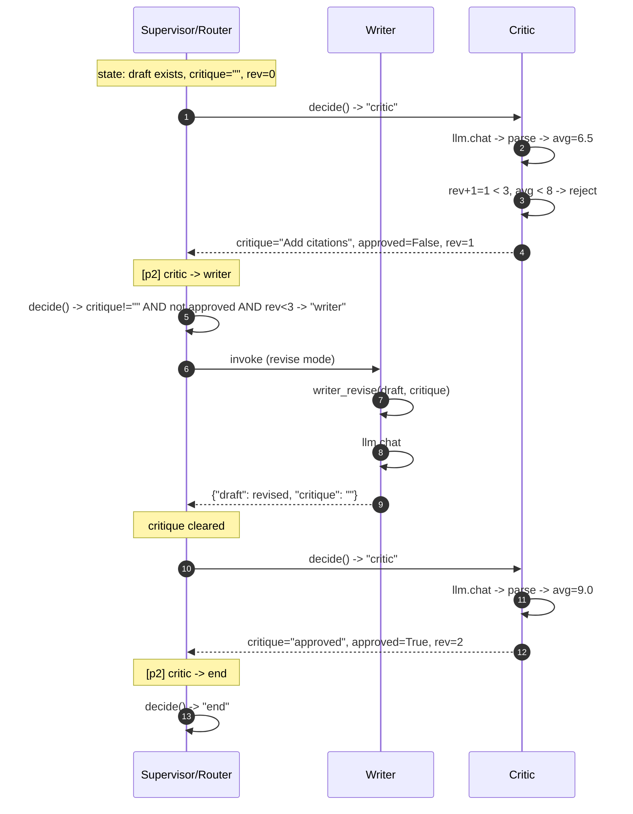

**Worst case:** every Critic pass rejects. `revision_count` goes
`0 -> 1 -> 2 -> 3`. At `rev=3`, `new_count >= MAX_REVISIONS` forces
approve. Total: 1 researcher + 3 writer + 3 critic.

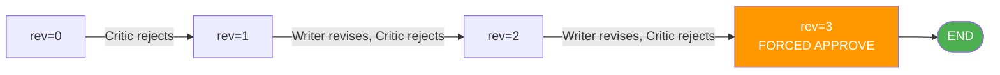

---

## 6. Memory layer call graph

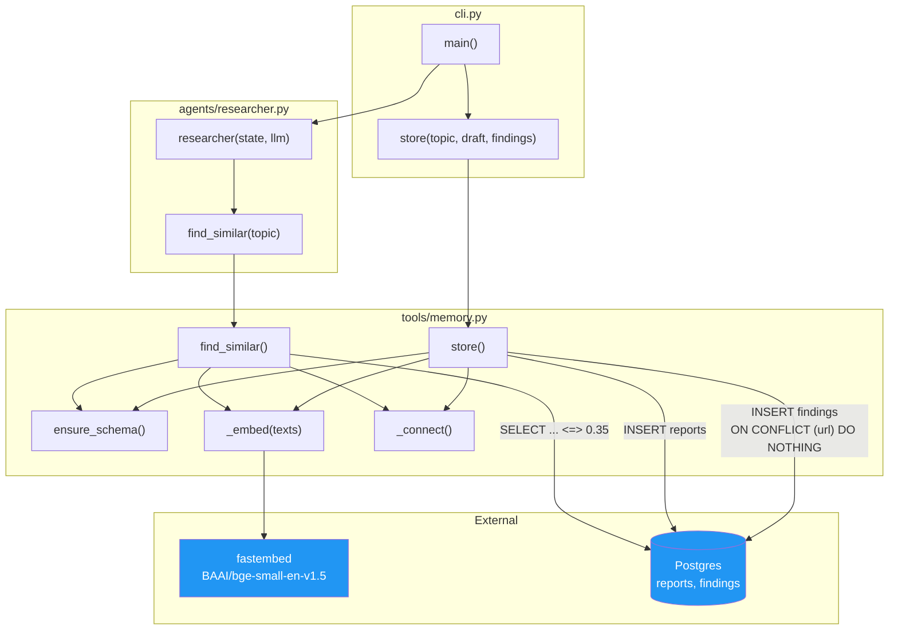

**Why best-effort:** every arrow into `memory.py` from `researcher.py`
or `cli.py` is wrapped in `try/except MemoryUnavailableError`. A dead
DB logs a warning and the run continues. The report is the product.

---

## 7. Tracing layer call graph

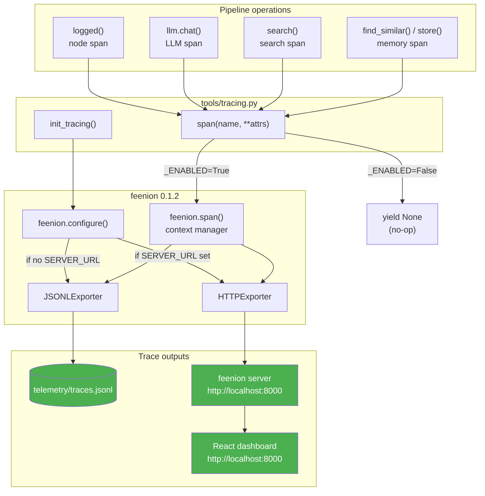

**Span names in a typical run** (feenion 0.1.2 does not nest, so all
are top-level):

```
researcher              (node span)
  memory.find_similar   (recall)
  llm.chat              (query gen)
  search                (x1 per query)
  llm.chat              (summary, x1 per finding)
  ...
writer                  (node span)
  llm.chat              (draft)
critic                  (node span)
  llm.chat              (score)
memory.store            (after approval)
```

All spans share the same `session_id`, which equals the checkpoint
`thread_id`. That is the only grouping available.

---

## 8. Every exit point

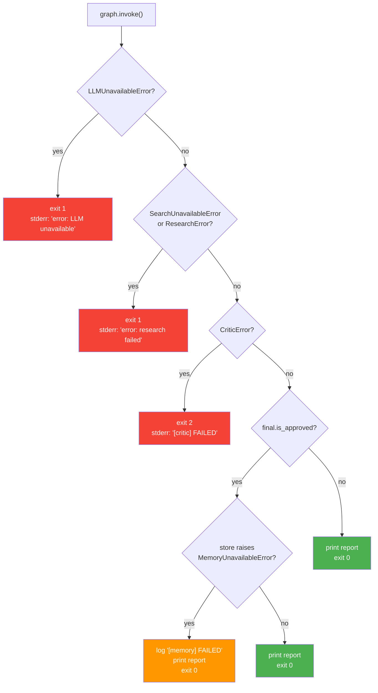

**Aborts (exit 1 or 2):** the run cannot produce a report.
**Degrades (exit 0):** the run produces a report; a side service is
down but the product is unaffected.

---

## 9. Failure modes and their handling

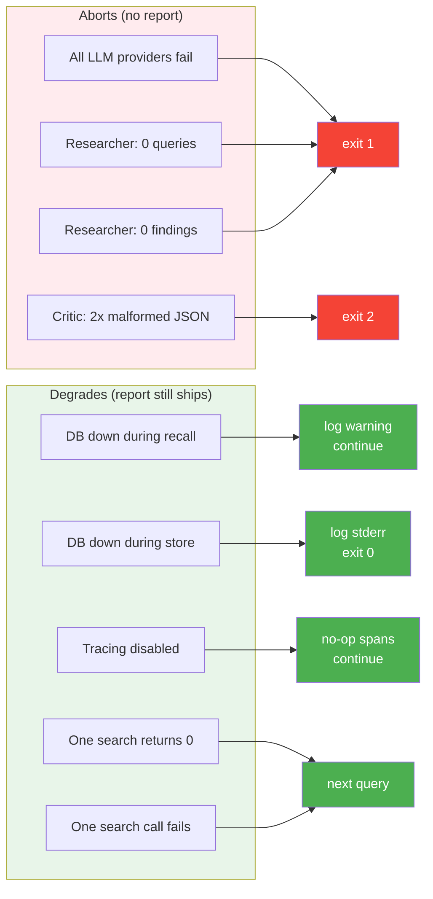

---

## 10. Data model

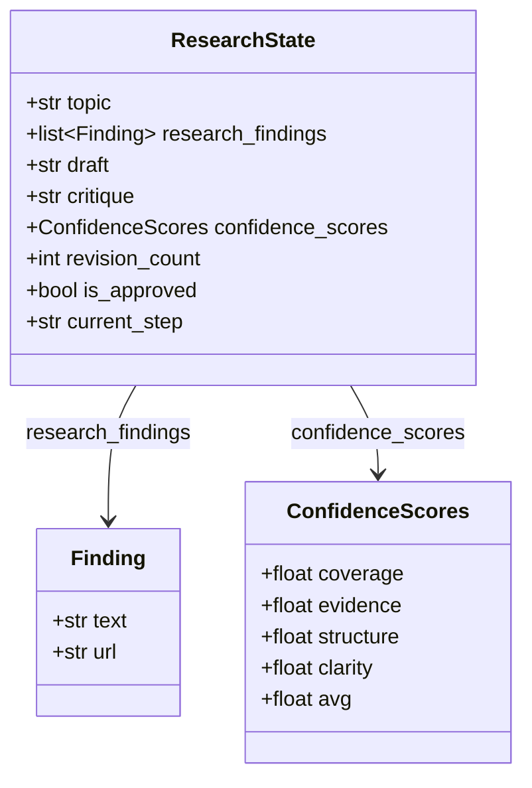

**The reducer.** `research_findings` is
`Annotated[list[Finding], add]`. When a node returns this key, LangGraph
runs `add(existing, returned)` — appends, does not overwrite. This is
why the Researcher returns only new findings (invariant 5). Returning
the full list would cause exponential duplication across revisions.

**The typed scorecard.** `ConfidenceScores` is `total=False` because
the initial state in `cli.py` passes `{}`. The Critic fills it.
`builder.py:_reason()` reads `avg` directly for the `[p2] critic` log
line.

---

## 11. Timing budget

A run targets under 30 seconds. Real measurements:

```mermaid
gantt
    title ResearchCrew run timing (typical, first-pass approval)
    dateFormat X
    axisFormat %S s

    section Startup
    get_llm + build_graph + init_tracing :0, 1

    section Researcher
    Recall from pgvector                 :1, 2
    Query generation (LLM)               :2, 3
    Search query 1                       :3, 6
    Summarize 1 (LLM)                    :6, 7
    Search query 2                       :7, 11
    Summarize 2 (LLM)                    :11, 12
    Search query 3                       :12, 15
    Summarize 3 (LLM)                    :15, 16
    Search query 4                       :16, 18
    Summarize 4 (LLM)                    :18, 19

    section Writer
    Draft generation (LLM)               :19, 24

    section Critic
    Score (LLM)                          :24, 26

    section Post-run
    Store to pgvector                    :26, 27
```

**Dominant cost:** search. `ddgs` returns in 2-5s per query, and the
Researcher runs up to 5 queries. `RESEARCH_BUDGET_S = 18` caps this. If
a search takes 6s, the Researcher stops at the next query boundary.

**Second cost:** the Writer's 3500-token output (4-6s on free tier).

**Cheapest:** the Critic (1-2s) because `max_tokens=800`.

---

## 12. Sequence of state changes

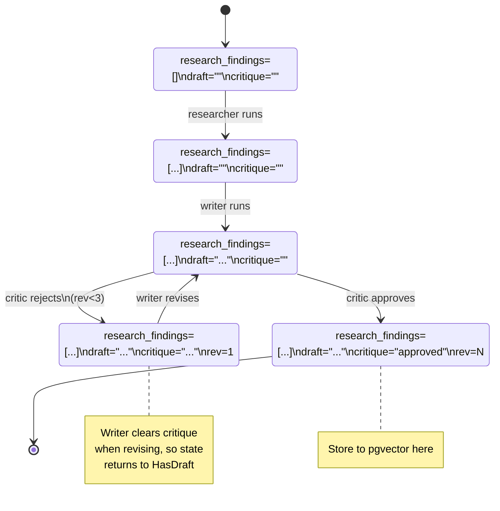

The three invariants that make this state machine safe:

1. **Writer clears `critique`** after drafting. Without this, the state
   would stay in `Rejected` forever.
2. **Critic always writes non-empty `critique`.** Empty means "Critic
   has not run yet." Writing `""` on approval would loop back to Critic.
3. **Supervisor reads only presence/absence of `critique`.** It never
   parses the text. Deterministic.

Breaking any of these produces an infinite loop. Each is tested
explicitly in `tests/test_supervisor.py`.

---

## 13. What the user sees

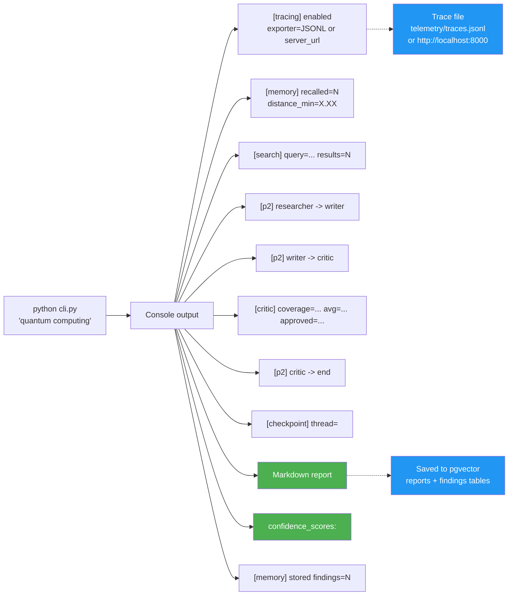

---

## 14. The whole system in one paragraph

`cli.py` builds an LLM client and a compiled graph, initializes tracing,
and invokes the graph with a blank `ResearchState`. `decide()` routes
the state to the Researcher, which recalls prior findings from pgvector,
generates search queries, runs live web searches, summarizes each
snippet with the LLM, and appends `{text, url}` findings to state. The
router sends the state to the Writer, which drafts a Markdown report
citing only those URLs. The router sends the state to the Critic, which
scores the draft on four dimensions, approves or rejects, and increments
the revision counter. If rejected and under the cap, the router sends
the state back to the Writer for a revision. When approved or capped,
the router sends to END. `cli.py` then prints the report and
`confidence_scores`, and persists the report and its findings to pgvector
so a later similar topic recalls them. Every step emits a span, either
to `telemetry/traces.jsonl` or to a self-hosted feenion server. Memory
and tracing failures are logged and ignored; LLM, research, and critic
failures abort with a non-zero exit code.